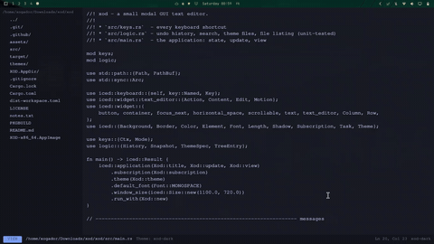

# xod




A small modal GUI text editor in Rust (built on [iced](https://iced.rs) 0.13).
Two modes like Vim: **view** (move, select, command keys, no typing) and **insert** (typing).
Left Ctrl and right Ctrl are separate keys with different jobs.

## Status: please read

This first version was written in a sandbox that could not download crates, so it has **never been
compiled**. What was checked there:

* `src/logic.rs` (undo history, search, cursor maths, theme parsing, file listing) compiles and passes
  its 13 unit tests (`rustc --edition 2021 --test src/logic.rs -o /tmp/t && /tmp/t`).
* `src/main.rs` and `src/keys.rs` passed a syntax check only. Expect to fix a few type or API errors
  on the first `cargo build`; they will be small and local. Send me the compiler output and I will fix them.

## Build and run

```sh
# Arch Linux runtime libs (if missing): sudo pacman -S vulkan-icd-loader mesa libxkbcommon wayland
cargo build --release
./target/release/xod notes.txt        # or: cargo install --path .   then:   xod notes.txt
```

If keys do nothing at startup, click inside the text once to give it focus.

## Keys

`Ctrl` alone means either Ctrl key. `LCtrl` / `RCtrl` mean that specific key.

| Action | Keys |
|---|---|
| Insert mode / back to view mode | `i` / `Esc` |
| Move | arrow keys (both modes) |
| Start / end of line | `RCtrl`+`Left` / `RCtrl`+`Right` (also Home / End) |
| Previous / next word | `LCtrl`+`Left` / `LCtrl`+`Right` |
| Start / end of file | `Ctrl`+`Space` (jumps to the start; press again at the start to go to the end) |
| Go to line | `LCtrl`+`H`, type the number, `Enter` |
| Page up / down | `RCtrl`+`Up` / `RCtrl`+`Down` |
| Delete line (view mode) | `LCtrl`+`Backspace` |
| Delete word (insert mode) | `LCtrl`+`Backspace` |
| Copy / cut / paste | `Ctrl`+`C` / `Ctrl`+`X` / `Ctrl`+`V` |
| Undo / redo, view mode | `U` / `R` |
| Undo / redo, insert mode | `Ctrl`+`Z` / `Ctrl`+`Y` or `Ctrl`+`Shift`+`Z` |
| Select text | hold `Shift` + arrows (also works with the Ctrl combos above) |
| Save | `Ctrl`+`S` (asks for a file name if the buffer has none) |
| Quit without saving | `Ctrl`+`Q` |
| Save and quit | `Ctrl`+`Shift`+`S` |
| File tree | `Ctrl`+`B` toggles it. In the tree: Up/Down, `Enter` opens, `Backspace`/Left = parent folder, `Esc` closes |
| Find | `Ctrl`+`F`, type, `Enter` = next, `Shift`+`Enter` = previous, `Esc` closes |
| Find and replace | `Ctrl`+`Shift`+`F`; `Tab` switches between the two fields; `Enter` in the replace field replaces the current match and moves on; `Ctrl`+`Enter` replaces all |
| Next / previous theme | `Ctrl`+`T` / `Ctrl`+`Shift`+`T` (my addition, you did not pick a key for this) |

All keys live in `src/keys.rs`, one line each, so changing one is easy.

## Themes

Six are built in: xod-dark, dracula, gruvbox-dark, nord, solarized-light, paper.
Make your own colors:

```sh
mkdir -p ~/.config/xod/themes
cp themes/example.toml ~/.config/xod/themes/
```

Edit the colors, save, and press `Ctrl`+`T`. The folder is re-read on every press, so you do not
need to restart. The last theme you used is remembered (`~/.config/xod/theme`).

## Known limits of v0.1

* No line-number gutter yet (the line and column are shown in the status bar).
* View mode has no block cursor; the status bar shows VIEW or INSERT.
* Undo keeps up to 300 whole-file snapshots; a run of letters typed together counts as one step.
* Opening a file from the tree is refused while the current one has unsaved changes.
* `Ctrl`+`Q` quits immediately, even with unsaved changes (that is what you asked for).
* Go to line and find move the cursor step by step, so they can pause briefly on very large files.
* Search is case-sensitive.
* If the OS does not report which Ctrl key is pressed, Ctrl acts as the left one.
